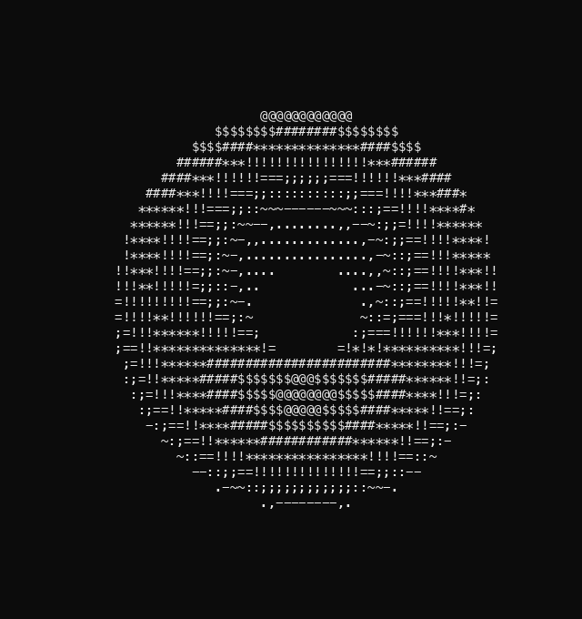

# donut.c

[This project](https://www.a1k0n.net/2011/07/20/donut-math.html) was the inspiration to start all this.

## Maths

### 1. Donut geometry

The donut is parameterised by two angles:

- $\theta$: angle around the tube
- $\phi$: angle around the hole

The distance from the donut's centre axis is:

$$
\rho=R_2+R_1\cos\theta
$$

Using this, a point on the surface is:

$$
\begin{aligned}
X&=\rho\cos\phi\\
Y&=\rho\sin\phi\\
Z&=R_1\sin\theta
\end{aligned}
$$

With $R_1=2$, $R_2=4$ and $K_2=8$.

### 2. Rotation

The donut rotates using two angles, $A$ and $B$. A 2D rotation is defined as:

$$
\begin{aligned}
p'_1&=p_1\cos a-p_2\sin a\\
p'_2&=p_1\sin a+p_2\cos a
\end{aligned}
$$

First, rotate in the $YZ$ plane by $A$:

$$
\begin{aligned}
y_A&=Y\cos A-Z\sin A\\
z_A&=Y\sin A+Z\cos A
\end{aligned}
$$

Substituting the donut coordinates:

$$
\begin{aligned}
y_A&=\rho\sin\phi\cos A-R_1\sin\theta\sin A\\
z_A&=\rho\sin\phi\sin A+R_1\sin\theta\cos A
\end{aligned}
$$

Then rotate in the $Xy_A$ plane by $B$:

$$
\begin{aligned}
x_{\mathrm{rot}}&=X\cos B-y_A\sin B\\
y_{\mathrm{rot}}&=X\sin B+y_A\cos B
\end{aligned}
$$

The rotation angles change over time:

$$
A=t,\qquad B=\frac{t}{2}
$$

### 3. Perspective projection

After rotation, the point's depth is shifted by $K_2$:

$$
z=K_2+z_A
$$

Perspective projection scales the coordinates by inverse depth. The point is mapped to a character cell on screen:

$$
\begin{aligned}
c&=C_X+K_{1X}x_{\mathrm{rot}}z^{-1}\\
r&=C_Y+K_{1Y}y_{\mathrm{rot}}z^{-1}
\end{aligned}
$$

Here, $(C_X,C_Y)$ is the screen centre and $(K_{1X},K_{1Y})=(30,15)$ controls the scale. The vertical scale is half the horizontal scale to account for the aspect ratio of terminal characters.

### 4. Depth

Multiple points can project onto the same character cell. To keep the closest surface visible, points are sorted by inverse depth, so nearer points overwrite farther ones.

Since a larger $z^{-1}$ means a point is closer, the depth buffer keeps the point with the largest inverse depth at each cell:

$$
\frac{1}{z}>D[c,r]
$$

If the condition holds:

$$
D[c,r]\leftarrow \frac{1}{z}
$$

The buffer starts at zero, so the first valid point always fills an empty cell.

### 5. Lighting

Each surface point has a normal describing the direction it faces:

$$
\mathbf n=
\begin{pmatrix}
\cos\theta\cos\phi\\
\cos\theta\sin\phi\\
\sin\theta
\end{pmatrix}
$$

The normal is rotated using the same rotations as the point.

First, by $A$:

$$
\begin{aligned}
n_{y,A}&=n_y\cos A-n_z\sin A\\
n_{z,A}&=n_y\sin A+n_z\cos A
\end{aligned}
$$

Then, by $B$:

$$
\begin{aligned}
n_{x,\mathrm{rot}}&=n_x\cos B-n_{y,A}\sin B\\
n_{y,\mathrm{rot}}&=n_x\sin B+n_{y,A}\cos B
\end{aligned}
$$

Brightness is determined by the dot product of the rotated normal and the light direction $\mathbf l$:

$$
L_{\mathrm{raw}}=\mathbf n_{\mathrm{rot}}\cdot\mathbf l
$$

A larger dot product means the surface faces the light more directly.

The brightness is scaled and clamped to select a character from the ramp:

$$
i=\operatorname{clamp}
\left(
\left\lfloor8L_{\mathrm{raw}}\right\rfloor,
0,11
\right)
$$

The character ramp is set to `.,-\~:;=!*#$@` (supported in all fonts).

The resulting index determines which character represents the point's brightness.
